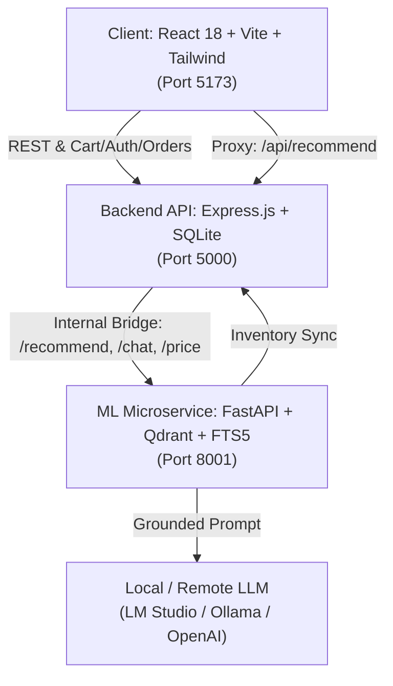

<div align="center">

# 🌸 Scentra — AI-Powered Fragrance Recommendation & Commerce Platform

<p align="center">
  <strong>An intelligent, end-to-end fragrance discovery ecosystem combining hybrid semantic retrieval, a community scent graph, real-time store inventory sync, and conversational AI.</strong>
</p>

[](#)
[](#)
[](#)
[](#)
[](#)
[](#)
[](#)
[](#)
[](#)
[](#)

---

[Key Features](#-key-features) •
[System Architecture](#-system-architecture) •
[Tech Stack](#-tech-stack) •
[Quick Start](#-quick-start) •
[API Reference](#-api-reference) •
[Directory Structure](#-project-structure)

---

</div>

## 🌟 Highlights

* **🧠 Hybrid Dense + Sparse Retrieval**: Combines semantic meaning (dense vector search via Qdrant) with exact name/note matching (sparse BM25 via SQLite FTS5) using rank-based **Reciprocal Rank Fusion (RRF)**.
* **🧬 Scent Relationship Graph & Dupe Finder**: Identifies clones, flankers, and alternative fragrances using explicit crowd-sourced community consensus ("reminds me of" votes) alongside olfactory note/accord fingerprints.
* **💬 Grounded Conversational AI**: Natural language fragrance advisor compatible with local LLMs (LM Studio, Ollama) and OpenAI-compatible endpoints. Features an articulate, rule-based fallback when offline.
* **🛍️ Inventory-Aware Recommendation**: Seamlessly mirrors local store stock into the recommendation pipeline, surfacing in-stock badges, prices, and one-click **Add to Cart** actions.
* **⚡ Ultra-Low Latency Caching**: Sub-millisecond response times for cached queries via LRU query vector caching and search-result memory TTL caches.
* **🛒 Complete E-Commerce Lifecycle**: Persistent cart for both authenticated and guest users, user wishlists, order placement & cancellation, dynamic blog feeds, and profile management.

---

## 🏛 System Architecture

Scentra is built as a three-tier system separating high-performance machine learning inference from business domain logic and user experience:



### Recommendation Request Pipeline

```
                     User Request ("sweet vanilla for winter nights")
                                         │
                                         ▼
                             [ Intent Router (intent.py) ]
                    Categorizes into: search · similar · price · new_releases
                    Extracts constraints: budget, gender, season, exclusions
                                         │
                   ┌─────────────────────┴─────────────────────┐
                   ▼                                           ▼
          [ Dupe / Clone Path ]                       [ Natural Search Path ]
      Graph Traversal (Edges)                     Hybrid Retrieval (Parallel)
      (clone_of, flanker_of, smells_like)         ├─ Dense: all-MiniLM-L6-v2 (Qdrant)
                   │                              └─ Sparse: BM25 Lexical (SQLite FTS5)
                   │                                           │
                   │                              [ Reciprocal Rank Fusion (RRF) ]
                   └─────────────────────┬─────────────────────┘
                                         ▼
                            [ Composite Reranker ]
                   - Scent Family & Occasion Fit (Canonical Vocab)
                   - Hard Negation Penalties ("not sweet", "no oud")
                   - Popularity vs Fit Dampening
                   - Optional: BAAI/bge-reranker-v2-m3 Cross-Encoder
                                         │
                                         ▼
                           [ Inventory Presentation ]
                   Matches against local store inventory:
                   (in_stock, live price, discount, cart hooks)
                                         │
                                         ▼
                         [ Grounded AI Explanation ]
                   LLM reasoning (or intelligent offline fallback narrative)
                                         │
                                         ▼
                         Frontend Cards + 1-Click Cart Hook
```

---

## 🛠 Tech Stack

| Domain | Technology | Purpose |
| :--- | :--- | :--- |
| **Frontend** | React 18, Vite, Tailwind CSS, Lucide | Responsive UI, chat assistant, product catalog, cart drawer |
| **Backend API** | Node.js, Express, SQLite3, JWT, Bcrypt | User authentication, store inventory, persistent cart, orders, blog |
| **ML Microservice** | Python 3.11+, FastAPI, Uvicorn | Recommendation service, intent routing, hybrid search, graph traversal |
| **Vector Engine** | Qdrant Client (Embedded / Local) | 384-dimensional dense semantic vector similarity store |
| **Keyword Search** | SQLite FTS5 (BM25) | High-speed exact name, brand, and note retrieval |
| **Embeddings** | `sentence-transformers` (`all-MiniLM-L6-v2`) | Compiles multi-attribute perfume profiles into semantic vector space |
| **Reranker** | Custom Olfactory Reranker + optional BGE Cross-Encoder | Query-aware composite scoring with exclusion penalties and MMR |
| **Data Scraping** | `curl_cffi`, Playwright, BeautifulSoup4 | Background Fragrantica scraper and community voting harvester |

---

## 🚀 Quick Start

### Prerequisites
* **Node.js** (v18 or later)
* **Python** (v3.11 or later)
* **Git**

---

### 1. Clone the Repository
```bash
git clone https://github.com/nawmee02/Scentra-Perfume-recomendation-system.git
cd Scentra-Perfume-recomendation-system
```

---

### 2. Configure Environment

Create a `.env` file in the root directory (or use default development fallbacks):

```env
PORT=5000
CLIENT_URL=http://localhost:5173
JWT_SECRET=scentra-development-jwt-secret-key-2024
SMTP_USER=
SMTP_PASS=
```

---

### 3. Start the Python ML Service

```bash
cd ml_service

# Install dependencies
pip install -r requirements.txt

# Run the FastAPI service on port 8001
python -m uvicorn main:app --host 127.0.0.1 --port 8001
```

> [!NOTE]
> On its initial run, the ML microservice automatically seeds its catalog from `data/fra_cleaned.csv` (~24k perfumes), synchronizes the shop inventory from the Node database, and encodes vectors into Qdrant. Subsequent startups take less than a second.

---

### 4. Start the Express Backend API

In a new terminal window:

```bash
cd Scentra-Perfume-recomendation-system

# Install Node dependencies (if not already done)
npm install

# Start the Express API server on port 5000
npm run server
```

---

### 5. Start the React Frontend

In another terminal window:

```bash
cd Scentra-Perfume-recomendation-system

# Start Vite development server
npm run dev
```

Visit **`http://localhost:5173`** in your browser.

---

## 🤖 Optional: Connect Local LLM (LM Studio / Ollama)

The system works out-of-the-box offline using structured explanation generation. If you wish to connect a local LLM:

1. Launch **LM Studio** and start the local inference server (default: `http://localhost:1234/v1`).
2. Load any chat-instruct model (e.g., `Qwen2.5-7B-Instruct`, `Llama-3-8B-Instruct`).
3. Scentra auto-detects the active model and routes natural language explanations through it.

---

## 📡 API Reference

### ML Microservice (`http://localhost:8001`)

| Method | Endpoint | Description |
| :--- | :--- | :--- |
| `GET` | `/health` | Health check: catalog counts, Qdrant vectors, LLM status, crawler progress |
| `POST` | `/recommend` | `{ "query": "fresh summer", "k": 5, "budget": 100 }` — hybrid retrieval |
| `POST` | `/chat` | `{ "query": "dupe for Sauvage", "k": 5 }` — intent-routed AI advisor |
| `POST` | `/price` | `{ "name": "Khamrah", "brand": "Lattafa" }` — live price search |
| `GET` | `/graph/node/{frag_id}` | Inspect relationship graph edges and confidence scores |
| `POST` | `/admin/reindex` | Trigger incremental Qdrant and FTS synchronization |

### Backend API (`http://localhost:5000`)

| Method | Endpoint | Description |
| :--- | :--- | :--- |
| `POST` | `/api/auth/register` | Create a new user account |
| `POST` | `/api/auth/login` | Authenticate user & return JWT token |
| `GET` | `/api/perfumes` | Paginated catalog with multi-facet filters & sorting |
| `GET` | `/api/cart` | Get current user / session cart items |
| `POST` | `/api/cart/add` | Add product to database-backed cart |
| `POST` | `/api/cart/update` | Update cart item quantity |
| `POST` | `/api/cart/remove` | Remove item from cart |
| `GET` | `/api/users/wishlist` | Retrieve authenticated user's wishlist |
| `POST` | `/api/users/wishlist` | Add perfume to wishlist (supports param or body) |
| `DELETE`| `/api/users/wishlist/:id`| Remove perfume from wishlist |
| `POST` | `/api/orders` | Place order with cart items & shipping details |
| `PUT` | `/api/users/orders/:id/cancel` | Cancel a pending order |
| `GET` | `/api/blog` | Fetch published fragrance blog posts |

---

## 🧪 Testing

### ML Service Unit & Regression Suite
Comprehensive test suite covering query understanding, negation, occasion fit, and voting heuristics:

```bash
cd ml_service
python -m pytest tests/ -q
```
```
............................................                             [100%]
44 passed in 17.00s
```

### Frontend Build Verification
```bash
npm run build
```

---

## 📁 Project Structure

```
Scentra-Perfume-recomendation-system/
├── ml_service/                       # Python ML & Retrieval Microservice
│   ├── ingestion/                    # Crawlers, scrapers & CSV seeders
│   ├── eval/                         # Ground truth benchmarks & metrics
│   ├── tests/                        # Pytest foundation & ranking tests
│   ├── agent.py                      # Intent router & single-call RAG presentation
│   ├── db.py                         # SQLite catalog, FTS5 & graph operations
│   ├── knowledge.py                  # Structured document compiler & content hashing
│   ├── qdrant_store.py               # Vector embedding upsert & similarity search
│   ├── query_features.py             # Negation parsing & query profiling
│   ├── ranking.py                    # Composite reranker with exclusion penalties
│   ├── relationship_service.py       # Entity resolution & dupe graph traversal
│   ├── search_service.py             # Dense/sparse RRF fusion & cache layer
│   ├── vocab.py                      # Closed-set canonical fragrance families
│   ├── settings.py                   # Centralized configuration & feature flags
│   └── main.py                       # FastAPI application entry point
├── server/                           # Express.js REST API
│   ├── database/                     # SQLite initialization, migrations & sample data
│   ├── middleware/                   # JWT & optional auth middlewares
│   ├── routes/                       # Express routes (auth, perfumes, cart, orders, etc.)
│   └── index.js                      # Backend server entry point
├── src/                              # React Frontend
│   ├── components/                   # UI components (Finder, Catalog, Cart, Profile, etc.)
│   ├── App.jsx                       # Main application shell & global cart state
│   ├── index.css                     # Tailwind CSS styling
│   └── main.jsx                      # Vite React root
├── package.json                      # Node dependencies & npm scripts
├── vite.config.js                    # Vite dev proxy configuration
└── .gitignore                        # Git security & repository hygiene rules
```

---

## 📄 License

This project is licensed under the [MIT License](LICENSE).
